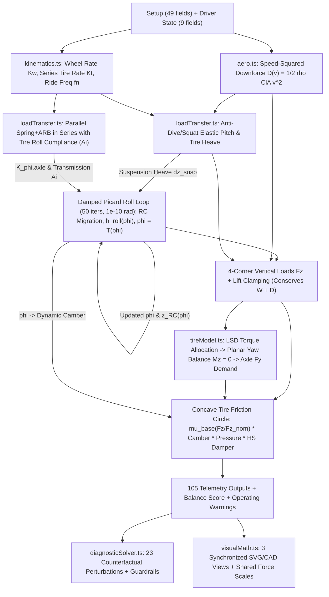
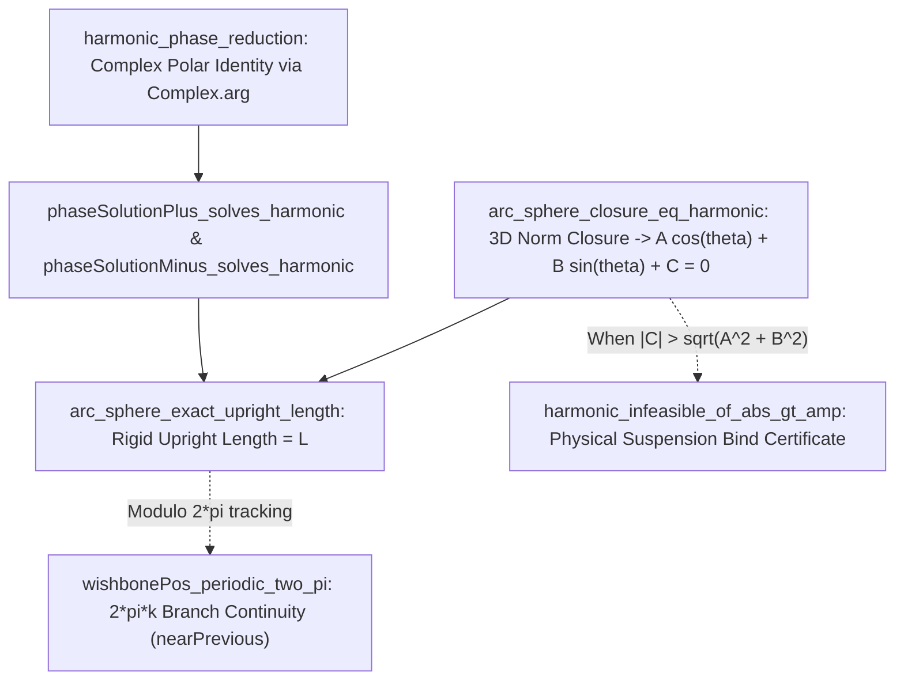
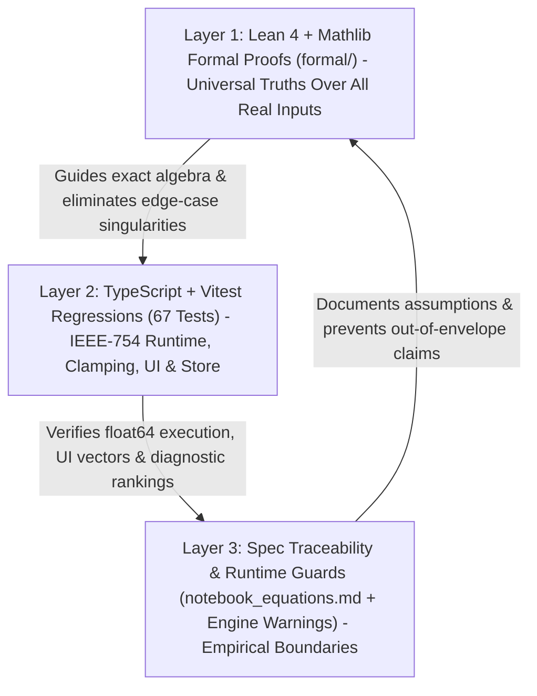

# Proving Race-Car Suspension Math

**A behind-the-scenes look at the mathematics of [Paddock Kinematics](https://github.com/MarshallJung/suspension_kinematics/blob/main/README.md), how Google Antigravity + Gemini 4 Neon turn multi-domain vehicle dynamics into rapid R&D, and why I and Antigravity paired TypeScript tests with machine-checked proofs in Lean 4.**

---

## From Paddock Slider to Formal Proof

As a Porsche Club of America driving instructor, I built [Paddock Kinematics](https://github.com/MarshallJung/suspension_kinematics) to solve a specific trackside communication problem: explaining why a car pushes on corner entry or snaps on exit when you are standing in a noisy paddock with spotty cell service. At first glance, the app looks like an interactive track-day sandbox—you drag a slider for front anti-roll bar stiffness, ride height, static camber, or aerodynamic downforce, and three synchronized engineering views update at 60 fps.

Making a slider feel effortless in the paddock is the easy part. Making sure the physics engine *never lies to a driver*—never loses vertical load during wheel lift, never divides by zero at full droop, and never hallucinates a setup recommendation when the car has already left its physical envelope—is where things get genuinely interesting.

Under the "hood", every slider movement evaluates a deterministic, multi-physics vehicle engine consisting of:

- **2,524 lines** of pure physics and diagnostic solver TypeScript across six engine modules ([3,280 lines](https://github.com/MarshallJung/suspension_kinematics/tree/main/src/engine) including presets and types), plus **339 lines** of display projection math in [`visualMath.ts`](https://github.com/MarshallJung/suspension_kinematics/blob/main/src/components/visualizer/visualMath.ts).
- **58 configuration and driver inputs** (**56 active** in live physics equations + 2 retained legacy inclination fields) producing **105 numeric telemetry outputs** across **3 corner phases** simultaneously (`Entry`, `Apex`, `Exit`), alongside a **20-scalar 3D spatial linkage solver** and **23 counterfactual setup perturbation rules**.
- **Six distinct mathematical disciplines** coupled inside a single quasi-static solver loop.
- **Three verification layers** locking down internal mathematical correctness:
  1. **1,262 lines of Lean 4 + Mathlib** ([`formal/`](https://github.com/MarshallJung/suspension_kinematics/blob/main/formal/README.md)) proving **37 public theorems** (+ 8 helper lemmas) across the continuous real numbers $\mathbb{R}$, with zero `sorry` placeholders and zero custom axioms.
  2. **1,423 lines of engine regression tests** ([`src/engine/__tests__/`](https://github.com/MarshallJung/suspension_kinematics/tree/main/src/engine/__tests__)) covering 56 independent physics/solver assertions (**67 total tests** across 7 Vitest suites).
  3. **A living equation specification** ([`notebook_equations.md`](https://github.com/MarshallJung/suspension_kinematics/blob/main/docs/notebook_equations.md)) and runtime operating-envelope guards that explicitly separate first-principles identities from illustrative empirical profiles.

This piece answers three questions:
1. **How complex is the math in this application, objectively?**
2. **Why is building and maintaining physics code like this straightforward—and mathematically verifiable—using Google Antigravity and Gemini 4 Neon?**
3. **What is the Lean 4 theorem-proving language, where does it legitimately apply to race-car math, and what did we actually prove with it here (including a full walkthrough of our 3D double-wishbone proof in [`SpatialLinkage.lean`](https://github.com/MarshallJung/suspension_kinematics/blob/main/formal/PaddockKinematics/SpatialLinkage.lean))?**

---

## 1. Placing the Engine Honestly: The 5-Tier Motorsport Modeling Ladder

Before calling any vehicle model "complex," we need an honest yardstick. Motorsport simulation spans everything from one-page intro textbook scripts to Formula 1 driver-in-the-loop (DIL) rigs. Paddock Kinematics intentionally targets **Tier 3**—capturing the real nonlinear coupling that causes trackside handling surprises, while staying sub-millisecond, offline-first, and free of OEM lab calibration data:

| Tier | Model Class | Typical Tools | What It Models | Where Paddock Kinematics Sits |
| :---: | :--- | :--- | :--- | :--- |
| **Tier 1** | **Linear Bicycle Model** | Intro textbook / 1-page script | 2 wheels, constant $\mu$, small slip angles, no roll/pitch/load transfer | *Surpassed* |
| **Tier 2** | **Uncoupled Static Weight Transfer** | Club-racer spreadsheets | Closed-form $\Delta F_z$, rigid tires, fixed roll centers, no feedback loops | *Surpassed* |
| **Tier 3** | **Coupled Nonlinear 4-Wheel Quasi-Static Kinematics & Tire Engine** | **Paddock Kinematics** | Series tire + spring/ARB compliance, transmitted geometric roll moments, iterated nonlinear roll equilibrium with RC migration, concave combined-slip tires, exact planar yaw closure, standalone 3D arc–sphere linkage solver | **Here** |
| **Tier 4** | **Time-Domain Multibody ODE Simulator** | CarSim, 14-DOF Simulink | Integrates $\dot{v}_y, \dot{r}, \ddot{\phi}, \ddot{z}_u$ in time; fitted 60–100+ coefficient Magic Formula tires; measured shock-dyno velocity curves | *Out of scope (intentionally interactive & zero-OEM-calibration)* |
| **Tier 5** | **Full Elastokinematic DAE + CFD/FEA** | Adams/Car, OEM / F1 DIL | Flexible bushings, multi-body hardpoint constraints, transient thermo-mechanical tires, coupled 3D aero maps | *Out of scope* |

> **Key Takeaway:** Paddock Kinematics is **not** a time-domain multibody ODE simulator—and [`notebook_equations.md`](https://github.com/MarshallJung/suspension_kinematics/blob/main/docs/notebook_equations.md) is explicit about where its generic tire, camber, and damper profiles are illustrative educational assumptions rather than OEM calibration fits. At the same time, **Tier 3** is far more intricate than a spreadsheet: it solves coupled algebraic, geometric, and implicit nonlinear equilibrium equations under strict conservation laws in sub-millisecond time.

> **Trackside Glossary (Five Terms Before We Dive In):**
> - **Roll Center (RC):** The virtual instantaneous pivot point where cornering forces cross from the tire contact patches into the chassis; its vertical distance below the center of gravity ($h_{\text{roll}}$) sets how hard the body tries to lean.
> - **Motion Ratio ($\mathrm{MR}$):** The geometric leverage linking wheel travel to spring/damper travel; wheel stiffness scales with $\mathrm{MR}^2$.
> - **Damped Picard Iteration:** A fixed-point loop that solves coupled nonlinear equations step by step by blending half of the old guess with half of the new one ($\phi_{n+1} = \frac{1}{2}(\phi_n + T(\phi_n))$) so feedback loops converge smoothly instead of oscillating.
> - **Jensen's Inequality (Tire Concavity):** Because tire grip grows with vertical load at a diminishing rate ($F''_{\max} < 0$), adding $1{,}000\,\text{N}$ to the outside tire never recovers the grip lost by removing $1{,}000\,\text{N}$ from the inside tire.
> - **Friction Circle:** The total horizontal traction budget of a tire ($\sqrt{F_x^2 + F_y^2} \le \mu F_z$)—meaning every unit of braking or throttle demand eats directly into available cornering grip.

---

## 2. Quantifying Mathematical Complexity: Three Lenses

A single metric cannot capture the difficulty of physics software. Looking at the codebase through three complementary lenses gives a concrete picture.

### Lens A: The 6-Axis Mathematical Complexity Scorecard

| Complexity Axis | Measurement in This Repository | Why It Matters |
| :--- | :--- | :--- |
| **1. State Dimensionality** | **56 active inputs** (47 `VehicleSetup` + 9 `DriverInputState`) $\to$ **105 numeric outputs** $\times$ 3 phases + **23 counterfactuals** | High fan-in/fan-out: changing tire pressure alters vertical tire rate $K_t$, ride frequency $f_n$, series roll transmission $A_i$, roll angle $\phi$, lateral load transfer $\Delta F_{z,\text{lat}}$, tire load sensitivity $\mu_{\text{base}}$, pressure efficiency, slip stiffness, and balance score simultaneously. |
| **2. Nonlinear Coupling & Feedback** | Cyclic fixed-point loop (`50` max steps, $10^{-10}\,\text{rad}$ tolerance) linking heave, pitch, roll-center migration ($\propto \phi^2$), and roll stiffness | Pitch alters suspension heave $\Delta z_{\text{susp}}$; heave and roll migrate the roll centers $z_{\text{RC}}(\phi)$; roll-center migration shifts $h_{\text{roll}}(\phi)$ and transmitted geometric moments $A_i G_i$, which feed right back into $\phi$. |
| **3. Solver & Method Diversity** | **5 distinct solver paradigms** in one engine: closed-form algebra, bounded inverse solver, damped Picard iteration, 3D analytic geometry, constrained counterfactual search | Requires handling singularities, asymptotes, non-unique branches, and non-convergence gracefully in every mode. |
| **4. Invariant & Conservation Density** | **8+ strict physical laws** enforced simultaneously across normal loads, yaw moments, $0g$ symmetry, mirror turns, tire concavity, and linkage closure | Violating any single invariant (e.g., losing 50 N of vertical load during wheel lift or breaking $0g$ symmetry) immediately invalidates downstream handling balance. |
| **5. Boundary & Singularity Density** | **6 runtime operating-limit guards** (`wheel_lift`, `axle_lift`, `roll_equilibrium`, `tire_saturation`, `over_lowered_rc`, `stationary_force_request`) + 0-steer / $\theta = \pi$ / tire-asymptote elimination | Naive formulas blow up at $\theta = \pi$, $A_y = 0$, $v = 0$, $F_z = 0$, $K_{\text{ride,target}} \ge K_t$, or $K_\phi \le W h_{\text{roll}}$. |
| **6. Epistemic Hygiene** | Strict separation between **first-principles identities** and **empirical teaching profiles** (`candidate_only` fallback in [`diagnosticSolver.ts`](https://github.com/MarshallJung/suspension_kinematics/blob/main/src/engine/diagnosticSolver.ts)) | The solver refuses to fabricate quantitative rankings when a car lifts a wheel, saturates a tire, or asks about an unmodeled transient symptom. |

### Lens B: Six Mechanical Engineering Courses Running in One Loop

For drivers and engineers outside pure numerical computing, the clearest way to see the math is that every drag of a slider exercises **six upper-division mechanical engineering disciplines** together:

| Subsystem | Source Module | Mathematical Core | Track-Day Paradox It Captures |
| :--- | :--- | :--- | :--- |
| **1. 3D Rigid-Body Linkage Kinematics** | [`kinematics.ts`](https://github.com/MarshallJung/suspension_kinematics/blob/main/src/engine/kinematics.ts#L91-L259) | 3D Euclidean vector geometry, orthonormal basis construction, circle–sphere intersection reduced to $A\cos\theta + B\sin\theta + C = 0$ and solved in phase-amplitude form | How unequal-length wishbones create negative camber gain in bump—and when suspension travel hits physical bind (`infeasible`). |
| **2. Elastomechanics & Vibrations** | [`kinematics.ts`](https://github.com/MarshallJung/suspension_kinematics/blob/main/src/engine/kinematics.ts#L267-L464) | Virtual work ($K_w = K_s\,\mathrm{MR}^2$), hollow-cylinder torsion ($J \propto D_o^4 - D_i^4$), parallel/series harmonic stiffness networks, exact target inversion | **The Tire-Stiffness Ceiling:** Stiffening main springs or ARBs arbitrarily stiff can never push ride frequency or axle roll stiffness past the tire's own vertical/roll compliance. |
| **3. Coupled Nonlinear Roll & Pitch Equilibrium** | [`loadTransfer.ts`](https://github.com/MarshallJung/suspension_kinematics/blob/main/src/engine/loadTransfer.ts#L186-L380) | Implicit fixed-point balance $(K_\phi - W h_{\text{roll}}(\phi))\phi = W A_y h_{\text{CG}} - \sum A_i G_i(\phi)$, anti-dive/anti-squat elastic decoupling, piecewise lift clamping | **The Over-Lowering Trap:** Lowering a MacPherson strut car drops its roll center underground *faster* than it lowers the CG, increasing $h_{\text{roll}}$ and making body roll *worse*. |
| **4. Nonlinear Tire Tribology & Planar Yaw Statics** | [`tireModel.ts`](https://github.com/MarshallJung/suspension_kinematics/blob/main/src/engine/tireModel.ts#L60-L339) | Globally strictly concave load sensitivity, isotropic friction circle, planar $\sum M_z = 0$ coupling of LSD longitudinal lock into axle lateral demand | **Jensen's Inequality on Asphalt:** Because tire grip vs. vertical load bends downward ($F''_{\max} < 0$), transferring load from inside to outside *always* reduces net axle grip. |
| **5. Speed-Squared Aerodynamics & Steering Geometry** | [`aero.ts`](https://github.com/MarshallJung/suspension_kinematics/blob/main/src/engine/aero.ts), [`kinematics.ts`](https://github.com/MarshallJung/suspension_kinematics/blob/main/src/engine/kinematics.ts#L580-L670) | Quadratic dynamic pressure ($D = \frac{1}{2}\rho C_L A v^2$), reference-speed reparameterization invariance, Ackermann + caster/KPI steer camber | Aero downforce enlarges every friction circle with $v^2$ while adding **zero** inertial cornering mass—unlike ballast. |
| **6. Counterfactual Sensitivity Search** | [`diagnosticSolver.ts`](https://github.com/MarshallJung/suspension_kinematics/blob/main/src/engine/diagnosticSolver.ts#L633-L753) | Constrained discrete perturbation across 23 physical blueprints, filtering non-improving, over-cambered, or out-of-envelope patches | Why stiffening a rear ARB helps cure mid-corner understeer yet can hurt corner-exit traction by unloading the inside driven tire. |

### Lens C: System Coupling & Feedback Architecture

Nothing conveys coupled complexity faster than tracing where values feed *back* into upstream geometry. In Paddock Kinematics, aerodynamic load, elastic pitch, roll-center migration, body roll, and yaw allocation form a tightly coupled directed graph with a nonlinear fixed-point loop at its center:



---

## 3. Why Naive Physics Code Fails: Seven Subtle Footguns

When someone asks *"can't a developer just write the textbook formulas in an afternoon?"*, the honest answer is that textbook snippets hide **integration traps** where two individually "correct" equations silently break conservation laws when wired together. Every item below is a concrete physics bug that Paddock Kinematics explicitly avoids and locks down with automated tests:

1. **Double-Counting Series Tire Compliance on Anti-Roll Bars**
   - **The Naive Trap:** Compute `K_ride` (springs in series with tires), convert `K_ride` into spring roll stiffness, and *then* add $K_{\phi,\text{ARB}}$ directly in parallel. That accidentally bypasses tire compliance for the anti-roll bar!
   - **The Implemented Fix ([`loadTransfer.ts:92-103`](https://github.com/MarshallJung/suspension_kinematics/blob/main/src/engine/loadTransfer.ts#L92-L103)):** Combine springs and ARB in parallel first, then place tire roll compliance $K_{\phi,\text{tyre}}$ in series:
     $$K_{\phi,\text{susp}} = K_{\phi,\text{spring}} + K_{\phi,\text{ARB}}, \qquad A_{\text{axle}} = \frac{K_{\phi,\text{tyre}}}{K_{\phi,\text{susp}} + K_{\phi,\text{tyre}}}$$
     Tested directly in [`dynamics-regressions.test.ts:93-104`](https://github.com/MarshallJung/suspension_kinematics/blob/main/src/engine/__tests__/dynamics-regressions.test.ts#L93-L104).

2. **Forgetting Transmitted Geometric Moments ($A_i G_i$) Under Compliant Tires**
   - **The Naive Trap:** Use the rigid-tire textbook equation $(K_\phi - W h_{\text{roll}}) \phi = W A_y h_{\text{roll}}$. When tires are elastic, lateral force transmitted directly through the roll center still deflects the tire sidewall even though it bypasses the suspension spring.
   - **The Implemented Fix ([`loadTransfer.ts:223-301`](https://github.com/MarshallJung/suspension_kinematics/blob/main/src/engine/loadTransfer.ts#L223-L301)):** Solves the coupled compliance balance:
     $$(K_{\phi,\text{total}} - W h_{\text{roll}})\,\phi = W A_y h_{\text{CG}} - (A_f G_f + A_r G_r)$$
     and recovers $W A_y h_{\text{roll}}$ strictly in the rigid-tire limit $K_t \to \infty$ ($A_i \to 1$).

3. **Double-Counting Inclination Angles and Rigid-Body Roll Camber**
   - **The Naive Trap:** Multiply a measured axial motion ratio $\mathrm{MR}$ by $\sin(\text{inclination})$ a second time, or multiply rigid-body roll $\phi$ by an empirical `rollCamberLossFactor` while *also* adding bump camber gain $(\mathrm{d}\gamma/\mathrm{d}z)\,\Delta z$.
   - **The Implemented Fix ([`kinematics.ts:267-273`](https://github.com/MarshallJung/suspension_kinematics/blob/main/src/engine/kinematics.ts#L267-L273), [`L644-L664`](https://github.com/MarshallJung/suspension_kinematics/blob/main/src/engine/kinematics.ts#L644-L664)):** Uses $K_w = K_s \cdot \mathrm{MR}^2$ exactly once, applies $1{:}1$ rigid-body roll $\pm\phi$ relative to ground, and isolates `rollCamberLossFactor` strictly to quadratic roll-center drop.

4. **The Weierstrass Half-Angle Singularity in 3D Wishbone Closure**
   - **The Naive Trap:** Solve $A\cos\theta + B\sin\theta + C = 0$ via the classic half-angle substitution $t = \tan(\theta/2)$, turning it into $(C - A)t^2 + 2Bt + (C + A) = 0$. When $C = A$, the leading quadratic coefficient vanishes ($0 \cdot t^2$), dividing by zero; when $\theta = \pi$, $t \to \infty$.
   - **The Implemented Fix ([`kinematics.ts:221-229`](https://github.com/MarshallJung/suspension_kinematics/blob/main/src/engine/kinematics.ts#L221-L229)):** Uses the phase-amplitude form:
     $$R\cos\!\big(\theta - \operatorname{atan2}(B, A)\big) = -C, \qquad R = \operatorname{hypot}(A, B)$$
     eliminating every algebraic division-by-zero singularity while tracking assembly branches continuously modulo $2\pi$. *(We walk through the complete Lean 4 proof of this solver in Section 4 below.)*

5. **Non-Concave Tire Load Sensitivity Under Heavy Aero Downforce**
   - **The Naive Trap:** Use a naive linear drop $\mu = \mu_0 \big(1 - k (F_z / F_{\text{nom}} - 1)\big)$ or an unguarded exponential that turns *negative* or *non-concave* at high downforce loads ($F_z \gg F_{\text{nom}}$), violating physical monotonicity.
   - **The Implemented Fix ([`tireModel.ts:163-167`](https://github.com/MarshallJung/suspension_kinematics/blob/main/src/engine/tireModel.ts#L163-L167)):** Blends a shifted power curve and a hyperbolic rational curve so normalized peak force $F_{\max}(r)$ stays **strictly increasing and globally strictly concave** for all $r \ge 0$.

6. **Mixing Spring Elastic Pitch Loads With Tire Normal Deflection (and Missing IRS Wheel Radius)**
   - **The Naive Trap:** Multiply tire deflection by $(1 - \%\,\mathrm{AD})$ during braking, or use ground-referenced $Z_{\text{SVIC}} / X_{\text{SVIC}}$ for an Independent Rear Suspension (`irs`) where tractive torque reacts through chassis-mounted differential half-shafts at wheel-center height $r_w$.
   - **The Implemented Fix ([`loadTransfer.ts:201-221`](https://github.com/MarshallJung/suspension_kinematics/blob/main/src/engine/loadTransfer.ts#L201-L221), [`kinematics.ts:695-716`](https://github.com/MarshallJung/suspension_kinematics/blob/main/src/engine/kinematics.ts#L695-L716)):** Springs see elastic load $E_i$, tires see full normal load $\Delta F_{\text{normal},i}$, and IRS anti-squat subtracts $r_w = 330\,\text{mm}$ from $Z_{\text{SVIC}}$.

7. **Leaking LSD Deceleration Torque Into Non-Driven Axles or Lifted Wheels**
   - **The Naive Trap:** Apply `lsdDecelLockPct` across both axles or keep assigning braking force to an airborne inside wheel ($F_z = 0$).
   - **The Implemented Fix ([`tireModel.ts:75-91`](https://github.com/MarshallJung/suspension_kinematics/blob/main/src/engine/tireModel.ts#L75-L91)):** Hydraulic brakes on non-driven axles stay strictly 50/50, lifted wheels carry $F_x = 0$, and any differential torque asymmetry is balanced back through `frontLateralDemandN` so planar yaw moment $\sum M_z = 0$ holds identically.

---

## 4. Case Study: Proving 3D Wishbone Closure Without Singularities (`SpatialLinkage.lean`)

To see what formal verification looks like on real suspension geometry—not a toy textbook exercise—let's zoom into [`formal/PaddockKinematics/SpatialLinkage.lean`](https://github.com/MarshallJung/suspension_kinematics/blob/main/formal/PaddockKinematics/SpatialLinkage.lean), the 273-line Lean 4 module that certifies our 3D double-wishbone solver [`trySolveDoubleWishboneArcSphere`](https://github.com/MarshallJung/suspension_kinematics/blob/main/src/engine/kinematics.ts#L163-L250).

### The Geometry Problem in Plain English

In a 3D double-wishbone suspension corner:
1. Rotating the **lower wishbone** by ride angle $\theta_{\text{lower}}$ places the lower ball joint at a known 3D point $\mathbf{p}_{\text{lower}}$.
2. As the **upper wishbone** pivots about its inboard chassis axis in an orthonormal plane spanned by unit vectors $(\mathbf{u}, \mathbf{v})$, the upper ball joint sweeps a circle of radius $R_u$ around pivot center $\mathbf{c}$:

$$\mathbf{p}_{\text{upper}}(\theta) = \mathbf{c} + R_u \cos\theta\,\mathbf{u} + R_u \sin\theta\,\mathbf{v}$$

3. The upright connecting those two ball joints is a rigid metal casting of fixed length $L$. Closing the linkage means finding the upper wishbone angle $\theta$ where the Euclidean distance between the ball joints equals $L$:

$$\|\mathbf{p}_{\text{upper}}(\theta) - \mathbf{p}_{\text{lower}}\|^2 = L^2$$

Expanding that squared 3D norm using $\boldsymbol{\delta}_c = \mathbf{c} - \mathbf{p}_{\text{lower}}$ and orthonormality ($\mathbf{u}\cdot\mathbf{u} = \mathbf{v}\cdot\mathbf{v} = 1$, $\mathbf{u}\cdot\mathbf{v} = 0$) collapses the entire 3D geometry problem into a single scalar harmonic equation:

$$A\cos\theta + B\sin\theta + C = 0$$

where:

$$A = 2 R_u (\mathbf{u} \cdot \boldsymbol{\delta}_c), \qquad B = 2 R_u (\mathbf{v} \cdot \boldsymbol{\delta}_c), \qquad C = \|\boldsymbol{\delta}_c\|^2 + R_u^2 - L^2$$

Instead of the brittle Weierstrass half-angle substitution $t = \tan(\theta/2)$, Paddock Kinematics solves the harmonic equation directly in **phase-amplitude form**:

$$\theta_{\pm} = \operatorname{atan2}(B, A) \pm \arccos\!\left(\frac{-C}{\sqrt{A^2 + B^2}}\right)$$

### How `SpatialLinkage.lean` Proves It End-to-End

Rather than checking a handful of test coordinates, `SpatialLinkage.lean` builds a five-part deductive chain over exact 3D Euclidean space $\mathbb{R}^3$:



Let's inspect the key compiled theorems directly from [`SpatialLinkage.lean`](https://github.com/MarshallJung/suspension_kinematics/blob/main/formal/PaddockKinematics/SpatialLinkage.lean):

#### Step 1: 3D Vector Closure Reduces to the Harmonic Equation (`lines 102–118`)

```lean
theorem arc_sphere_closure_eq_harmonic
    (center u v lowerPos : Vec3) (R L theta : ℝ)
    (hu : Vec3.dot u u = 1) (hv : Vec3.dot v v = 1) (huv : Vec3.dot u v = 0) :
    let deltaC := Vec3.sub center lowerPos
    let A := 2 * R * Vec3.dot u deltaC
    let B := 2 * R * Vec3.dot v deltaC
    let C := Vec3.dot deltaC deltaC + R ^ 2 - L ^ 2
    Vec3.normSq (Vec3.sub (wishbonePos center u v R theta) lowerPos) - L ^ 2 =
      A * Real.cos theta + B * Real.sin theta + C := by
  dsimp only
  simp only [Vec3.normSq, Vec3.dot, Vec3.sub, Vec3.add, Vec3.scale, wishbonePos] at hu hv huv ⊢
  have htrig : Real.cos theta ^ 2 + Real.sin theta ^ 2 = 1 := Real.cos_sq_add_sin_sq theta
  linear_combination
    (R ^ 2 * Real.cos theta ^ 2) * hu +
    (R ^ 2 * Real.sin theta ^ 2) * hv +
    (2 * R ^ 2 * Real.cos theta * Real.sin theta) * huv +
    (R ^ 2) * htrig
```

Notice how clean that is: unfolding `Vec3` arithmetic and feeding Lean's `linear_combination` tactic the four unit-basis and Pythagorean identities (`hu`, `hv`, `huv`, `htrig`) proves the 3D-to-1D reduction identically for *every* center, frame, radius, upright length, and angle.

#### Step 2: Both Phase-Amplitude Branches Solve the Equation With Zero Singularities (`lines 160–175`)

```lean
theorem phaseSolutionPlus_solves_harmonic {A B C : ℝ}
    (hamp : 0 < Real.sqrt (A ^ 2 + B ^ 2)) (hfeas : |C| ≤ Real.sqrt (A ^ 2 + B ^ 2)) :
    let theta := phaseSolutionPlus A B C
    A * Real.cos theta + B * Real.sin theta + C = 0 := by
  dsimp only [phaseSolutionPlus]
  rw [harmonic_phase_reduction]
  have hc := abs_le.mp hfeas
  have hle : -1 ≤ -C / Real.sqrt (A ^ 2 + B ^ 2) := by
    rw [le_div_iff₀ hamp]
    linarith [hc.2]
  have hge : -C / Real.sqrt (A ^ 2 + B ^ 2) ≤ 1 := by
    rw [div_le_one hamp]
    linarith [hc.1]
  rw [Real.cos_arccos hle hge]
  field_simp [hamp.ne']
  ring
```

**Why every hypothesis maps directly to runtime code:**
- `hamp` ($0 < \sqrt{A^2 + B^2}$) guarantees we never divide by zero when normalizing by amplitude $R_{\text{amp}}$.
- `hfeas` ($\lvert C \rvert \le \sqrt{A^2 + B^2}$) proves $-C / R_{\text{amp}} \in [-1, 1]$, which is the exact domain requirement for `Real.cos_arccos` to cancel identically—with **no** singularity at $\theta = \pi$ or $A = C$.
- The companion theorem `phaseSolutionMinus_solves_harmonic` proves the same identity for the `phase - arccos(...)` assembly branch.

#### Step 3: Proving Physical Suspension Bind Is Unsolvable (`lines 205–220`)

What happens when a driver enters extreme bump or droop travel and the linkage hits mechanical bind? Our TypeScript solver returns `infeasible`. Lean proves that this is **not** a solver limitation—no mathematical angle anywhere in $\mathbb{R}$ could close the upright:

```lean
theorem harmonic_infeasible_of_abs_gt_amp {A B C : ℝ}
    (hinf : Real.sqrt (A ^ 2 + B ^ 2) < |C|) (theta : ℝ) :
    A * Real.cos theta + B * Real.sin theta + C ≠ 0 := by
  intro heq
  have hcs : (A * Real.cos theta + B * Real.sin theta) ^ 2 ≤ A ^ 2 + B ^ 2 := by
    nlinarith [sq_nonneg (A * Real.sin theta - B * Real.cos theta), Real.sin_sq_add_cos_sq theta]
  have hsq : A ^ 2 + B ^ 2 < C ^ 2 := by
    have h1 : Real.sqrt (A ^ 2 + B ^ 2) ^ 2 < |C| ^ 2 := by
      nlinarith [Real.sqrt_nonneg (A ^ 2 + B ^ 2), abs_nonneg C]
    rw [Real.sq_sqrt (by positivity), sq_abs] at h1
    exact h1
  have h1 : A * Real.cos theta + B * Real.sin theta = -C := by linarith
  have hce : (A * Real.cos theta + B * Real.sin theta) ^ 2 = C ^ 2 := by
    rw [h1]
    ring
  linarith
```

#### Step 4: End-to-End 3D Rigid-Upright Closure (`lines 240–253`)

Finally, `arc_sphere_exact_upright_length` stitches Steps 1 and 2 together (and `wishbonePos_periodic_two_pi` certifies continuous $2\pi k$ branch selection for `nearPrevious`):

```lean
theorem arc_sphere_exact_upright_length
    (center u v lowerPos : Vec3) (R L : ℝ)
    (hL : 0 ≤ L) (hu : Vec3.dot u u = 1) (hv : Vec3.dot v v = 1) (huv : Vec3.dot u v = 0)
    (hamp : 0 < Real.sqrt ((2 * R * Vec3.dot u (Vec3.sub center lowerPos)) ^ 2 +
      (2 * R * Vec3.dot v (Vec3.sub center lowerPos)) ^ 2))
    (hfeas : |Vec3.dot (Vec3.sub center lowerPos) (Vec3.sub center lowerPos) + R ^ 2 - L ^ 2| ≤
      Real.sqrt ((2 * R * Vec3.dot u (Vec3.sub center lowerPos)) ^ 2 +
        (2 * R * Vec3.dot v (Vec3.sub center lowerPos)) ^ 2)) :
    let deltaC := Vec3.sub center lowerPos
    let A := 2 * R * Vec3.dot u deltaC
    let B := 2 * R * Vec3.dot v deltaC
    let C := Vec3.dot deltaC deltaC + R ^ 2 - L ^ 2
    Real.sqrt (Vec3.normSq (Vec3.sub (wishbonePos center u v R (phaseSolutionPlus A B C)) lowerPos)) = L ∧
      Real.sqrt (Vec3.normSq (Vec3.sub (wishbonePos center u v R (phaseSolutionMinus A B C)) lowerPos)) = L := by
```

---

## 5. Straightforward, Error-Free R&D in Google Antigravity + Gemini 4 Neon

Why does building an engine with **seven domain traps**, **105 coupled outputs**, and **three live visualizations** become straightforward when developed inside **Google Antigravity** with **Gemini 4 Neon**?

Two things change simultaneously:

1. **One Continuous Loop Replaces Multi-Team Translation Overhead.**
   Traditionally, a physics visualizer fragments across separate silos: a vehicle dynamicist writes equations in a notebook or MATLAB, a numerical programmer ports them to C++ or TypeScript (introducing sign flips and unit bugs in transit), and a frontend engineer guesses what the vectors mean on screen. Inside Antigravity, Gemini 4 Neon holds the **entire vertical stack** in one working loop:
   - **Derive** the equations from first principles $\to$
   - **Specify** exact sign conventions, units, and limits in [`notebook_equations.md`](https://github.com/MarshallJung/suspension_kinematics/blob/main/docs/notebook_equations.md) $\to$
   - **Implement** pure, side-effect-free TypeScript in [`src/engine/`](https://github.com/MarshallJung/suspension_kinematics/tree/main/src/engine) $\to$
   - **Independently Verify** via adversarial tests that re-derive physical identities from scratch rather than copying code formulas $\to$
   - **Autoformalize** core invariants into **Lean 4** so a completely independent mathematical kernel verifies them.

2. **What "Error-Free" Actually Means (An Honest Distinction).**
   To keep engineering credibility intact, we explicitly separate two kinds of correctness:
   - **Internal Mathematical & Algorithmic Soundness:** Do forces sum to $m g A_y$? Does yaw moment close to zero? Are vertical loads conserved and nonnegative even at wheel lift? Does the inverse frequency solver recover the exact target frequency? Is the tire curve strictly concave everywhere? **This half can be driven mathematically to zero defects**—using automated Vitest checks in Layer 2 and machine-checked Lean 4 proofs in Layer 1.
   - **External Empirical Calibration:** Does a specific 2024 GT3 Cup car on Michelin slicks at Sebring have `k_sens = 0.14` and $-0.052\,\text{deg/mm}$ bump camber gain? **No AI and no theorem prover can invent physical test data.** That belongs to Layer 3: labeling assumed teaching constants transparently and surfacing explicit warnings whenever the driver leaves the four-contact or small-angle envelope.

### The 3-Layer Verification Pyramid

Rather than relying on manual spot-checks or a single unit-test file, Paddock Kinematics uses three complementary verification layers—each catching failures the other two cannot see:



| Layer | Technology | What It Verifies | Sample Size | Blind Spot Covered by Other Layers |
| :--- | :--- | :--- | :--- | :--- |
| **Layer 1: Formal Proof** | **Lean 4 (`v4.36.0`) + Mathlib** ([`formal/`](https://github.com/MarshallJung/suspension_kinematics/tree/main/formal)) | Algebraic identities, conservation laws, global calculus concavity, singularities, convergence rates | **$\infty$** (universal $\forall x \in \mathbb{R}$) | Assumes exact real arithmetic $\mathbb{R}$; does not inspect TypeScript syntax or `float64` rounding |
| **Layer 2: Executable Regression** | **TypeScript + Vitest** ([`src/engine/__tests__/`](https://github.com/MarshallJung/suspension_kinematics/tree/main/src/engine/__tests__)) | Actual shipped TypeScript functions, IEEE-754 tolerances ($10^{-10}$–$10^{-6}$), Zustand store, SVG display math | **67 tests** across 7 suites | Only samples finite test fixtures; cannot prove "no counterexample exists anywhere" |
| **Layer 3: Epistemic Guardrails** | [`notebook_equations.md`](https://github.com/MarshallJung/suspension_kinematics/blob/main/docs/notebook_equations.md) + UI warnings | Separates equations from illustrative constants; flags wheel lift, tire saturation, failed roll convergence | **100%** of user-facing outputs | Does not verify algebra itself |

Notice the crucial trust story: **you do not have to trust Gemini 4 Neon's math.** When Gemini 4 Neon translates a physics equation into Lean 4 and constructs a proof, Lean's tiny, independent proof-checking kernel mechanically validates every deduction step. Either the proof compiles with zero `sorry` and standard axioms, or the compiler rejects it.

---

## 6. Lean 4 Explained for Engineers: Three More Live Proofs

### What Is Lean 4 in Plain English?

**Lean 4** is simultaneously a functional programming language and an **interactive theorem prover** built on dependent type theory (the *Curry–Howard correspondence*):

- In TypeScript, a function signature describes **data shape**:
  `calculateRideRateNmm(kw: number, kt: number): number`
- In Lean 4, a type can state an **arbitrary universal mathematical claim**:
  *"For **all** positive real numbers $K_w > 0$ and $K_t > 0$, $\frac{K_w K_t}{K_w + K_t} < K_t$."*
- Writing a `theorem` whose proof body type-checks against that signature **is** a formal proof. If there is a subtle division-by-zero edge case, a forgotten sign hypothesis, or a hidden discontinuity anywhere on $\mathbb{R}$, Lean refuses to compile.
- Even better, Lean includes `#print axioms MyTheorem`: it lets anyone audit that a theorem relies **only** on the three standard axioms of classical mathematics (`propext`, `Classical.choice`, `Quot.sound`)—never on an unproved stub (`sorryAx`) or a cheated custom axiom.

Every code block below is **verbatim** from our compiled [`formal/PaddockKinematics/`](https://github.com/MarshallJung/suspension_kinematics/tree/main/formal/PaddockKinematics) suite (built cleanly with `lake build` in Lean `v4.36.0`).

### Excerpt 1: Global Tire Concavity & Jensen's Inequality ([`TireConcavity.lean:307-341`](https://github.com/MarshallJung/suspension_kinematics/blob/main/formal/PaddockKinematics/TireConcavity.lean#L307-L341))

Our Vitest suite checks tire concavity at 9 sample loads. Lean proves it simultaneously for **every** load ratio $r \in [0, \infty)$ and **every** sensitivity exponent $k_{\text{sens}} \in (0, 1)$, and deduces why lateral weight transfer strictly hurts axle grip:

```lean
theorem tirePeakForceNorm_strictConcaveOn {mu0 k : ℝ}
    (hmu : 0 < mu0) (hk0 : 0 < k) (hk1 : k < 1) :
    StrictConcaveOn ℝ (Ici (0 : ℝ)) (tirePeakForceNorm mu0 k) := by
  refine StrictAntiOn.strictConcaveOn_of_deriv (convex_Ici 0) ?_ ?_
  · intro r hr
    exact (tirePeakForceNorm_hasDerivAt hk0.le hr).continuousAt.continuousWithinAt
  · rw [interior_Ici]
    intro x hx y hy hxy
    have hx' : deriv (tirePeakForceNorm mu0 k) x = tirePeakForceNormDeriv mu0 k x :=
      (tirePeakForceNorm_hasDerivAt hk0.le hx.le).deriv
    have hy' : deriv (tirePeakForceNorm mu0 k) y = tirePeakForceNormDeriv mu0 k y :=
      (tirePeakForceNorm_hasDerivAt hk0.le hy.le).deriv
    rw [hx', hy']
    exact tirePeakForceNormDeriv_strictAntiOn hmu hk0 hk1 hx.le hy.le hxy

theorem weight_transfer_strictly_reduces_axle_grip {mu0 k r0 delta : ℝ}
    (hmu : 0 < mu0) (hk0 : 0 < k) (hk1 : k < 1)
    (hd0 : 0 < delta) (hd_le : delta ≤ r0) :
    tirePeakForceNorm mu0 k (r0 - delta) + tirePeakForceNorm mu0 k (r0 + delta) <
      2 * tirePeakForceNorm mu0 k r0 := by
  have hconc := tirePeakForceNorm_strictConcaveOn hmu hk0 hk1
  have hm : r0 - delta ∈ Ici (0 : ℝ) := mem_Ici.mpr (sub_nonneg.mpr hd_le)
  have hp : r0 + delta ∈ Ici (0 : ℝ) := mem_Ici.mpr (by linarith)
  have hne : r0 - delta ≠ r0 + delta := by linarith
  have hj := hconc.2 hm hp hne (by norm_num) (by norm_num)
    (by norm_num : (1 / 2 : ℝ) + (1 / 2 : ℝ) = 1)
  have havg : (1 / 2 : ℝ) * (r0 - delta) + (1 / 2 : ℝ) * (r0 + delta) = r0 := by ring
  simp only [smul_eq_mul] at hj
  rw [havg] at hj
  linarith
```

**Line-by-line guide:**
- `Ici (0 : ℝ)` means the half-infinite interval $[0, \infty)$ ("Interval closed left, infinite right").
- `StrictAntiOn.strictConcaveOn_of_deriv` is a Mathlib calculus theorem: if a function is continuous on $[0, \infty)$ and its first derivative is strictly decreasing on $(0, \infty)$, the function is **strictly concave** on $[0, \infty)$.
- Inside `weight_transfer_strictly_reduces_axle_grip`, `hconc.2` unpacks strict concavity at the two loaded corners (`r0 - delta` inside, `r0 + delta` outside) with midpoint weights `1/2` and `1/2`; `linarith` multiplies both sides by `2` to prove total axle grip drops strictly. *(A follow-up theorem, `larger_weight_transfer_strictly_lowers_axle_grip`, goes further and proves that total grip decreases monotonically for any $0 \le d_1 < d_2 \le r_0$.)*

### Excerpt 2: Universal 4-Wheel Vertical Load Conservation Under Lift ([`LoadTransfer.lean:151-181`](https://github.com/MarshallJung/suspension_kinematics/blob/main/formal/PaddockKinematics/LoadTransfer.lean#L151-L181))

```lean
theorem four_wheel_vertical_load_conserved_and_nonneg (wTotal fzF rawLatF rawLatR : ℝ) :
    let dFzF := displayFrontAxleFz wTotal fzF
    let dFzR := displayRearAxleFz wTotal fzF
    let latF := clampedLat dFzF rawLatF
    let latR := clampedLat dFzR rawLatR
    0 ≤ outsideCornerFz dFzF latF ∧
      0 ≤ insideCornerFz dFzF latF ∧
      0 ≤ outsideCornerFz dFzR latR ∧
      0 ≤ insideCornerFz dFzR latR ∧
      outsideCornerFz dFzF latF + insideCornerFz dFzF latF +
        outsideCornerFz dFzR latR + insideCornerFz dFzR latR = max 0 wTotal := by
```

**Why this matters:** Notice there are **no extra preconditions** on `fzF`, `rawLatF`, or `rawLatR`! Even if extreme trail-braking and cornering request negative loads (lifting an inside wheel or an entire rear axle), the exact `max`/`min` clamping in [`loadTransfer.ts:316-350`](https://github.com/MarshallJung/suspension_kinematics/blob/main/src/engine/loadTransfer.ts#L316-L350) guarantees **zero negative tire forces** and **exact conservation** of total vertical load $\max(0, W + D)$.

### Excerpt 3: Exact Inverse Ride-Frequency Solver ([`RideFrequency.lean:139-144`](https://github.com/MarshallJung/suspension_kinematics/blob/main/formal/PaddockKinematics/RideFrequency.lean#L139-L144))

```lean
theorem solveSpringRate_pos_and_exact_inverse {fTarget kt mr mCorner : ℝ}
    (hf : 0 < fTarget) (hkt : 0 < kt) (hmr : 0 < mr) (hm : 0 < mCorner)
    (hlim : targetRideRate fTarget mCorner < kt) :
    0 < solveSpringRate fTarget kt mr mCorner ∧
      naturalFreqHz (rideRate (wheelRate (solveSpringRate fTarget kt mr mCorner) mr) kt) mCorner =
        fTarget := by
```

**Why this matters:** Proves that `solveRideFrequencyTarget` never produces negative springs and inverts the forward frequency equation **without approximation error** right up to the vertical tire-stiffness boundary `targetRideRate < kt`.

### Where Lean 4 Applies — And Where It Doesn't

| Applies Strongly (High ROI) | Does Not Apply (Wrong Tool) |
| :--- | :--- |
| Universal conservation laws ($\sum F_z$, $\sum F_y$, $\sum M_z = 0$) | Shipping runtime UI / React Native SVG rendering |
| Calculus proofs of monotonicity & global strict concavity (Jensen's inequality) | Discovering real-world tire Pacejka parameters or shock-dyno tables |
| Algebraic soundness of closed-form geometry & inverse solvers (singularity elimination) | IEEE-754 `float64` rounding behavior or JSON `localStorage` persistence |
| Contraction & convergence bounds for fixed-point loops ($\frac{1 + L}{2}$) | Proving a generic teaching profile matches a specific production race car |

---

## 7. Questions Engineers & Track Drivers Will Ask

### Q1: "Does a Lean 4 proof mean your suspension model matches a real Porsche 911 GT3 on track?"
**No—and confusing internal soundness with real-world calibration is the fastest way to lose an engineer's trust.** Lean proves that *given* the model's equations, forces conserve identically, the tire curve never goes non-concave, and the 3D linkage solver never divides by zero. Matching a specific real car's lap telemetry still requires measured spring/motion-ratio tables, hardpoints, damper dynos, and tire rig data (explicitly documented in [`notebook_equations.md`](https://github.com/MarshallJung/suspension_kinematics/blob/main/docs/notebook_equations.md)).

### Q2: "Wait—you wrote the proofs in Lean 4, but the app runs in TypeScript. What proves the TypeScript code matches the Lean spec?"
**That's exactly why Layer 2 (Vitest) exists alongside Layer 1 (Lean 4).** Every Lean module mirrors the exact line-by-line formulas of its TypeScript counterpart (`src/engine/`), and our 56 Vitest physics tests re-derive those exact identities against the executed TypeScript code in IEEE-754 `float64`. Lean eliminates algebraic/logical blind spots over $\mathbb{R}$; Vitest verifies the TypeScript translation and floating-point tolerances.

### Q3: "How do I know Gemini 4 Neon didn't hallucinate or cheat on a Lean proof?"
**Because Lean 4 is zero-trust.** An AI can hallucinate a plausible-looking Python test or math write-up, **but it cannot bluff Lean's type-checking kernel.** Every proof in `formal/PaddockKinematics/` is checked mechanically by `lake build`, verified to contain zero `sorry` placeholders, and audited with `#print axioms` to confirm it depends solely on `[propext, Classical.choice, Quot.sound]`.

### Q4: "Why not write the entire app in Lean 4 instead of TypeScript?"
Lean 4 compiles to C for CLI/backend tools, not React Native / Expo / SVG cross-platform mobile and web UIs, and mathematical functions over $\mathbb{R}$ (`Real.sqrt`, `Real.pi`) are `noncomputable` specifications rather than fast `float64` kernels. Keeping TypeScript for execution and Lean 4 as a companion `formal/` proof suite gives you both native cross-platform UX and formal certainty.

### Q5: "Lean uses infinite-precision real numbers $\mathbb{R}$, while TypeScript uses 64-bit floating point (`number`). Could float rounding still break something?"
Yes, floating-point rounding ($\sim 10^{-16}$ relative) matters near tolerances and subtractive cancellation—which is precisely why [`kinematics.ts`](https://github.com/MarshallJung/suspension_kinematics/blob/main/src/engine/kinematics.ts#L198-L236) uses scale-invariant tolerances ($10^{-10} \cdot \text{scale}$) and an explicit rigid-upright closure residual check (`Math.abs(closureResidual) > Math.max(1e-12, kingpinLength * 1e-9)`), and why Layer 2 tests verify numerical tolerances across $10^{-3}$ to $10^{4}$ unit scales.

### Q6: "How long does it take to verify this locally?"
About **15 seconds** after installing `elan` (`brew install elan-init`): `lake update` fetches Lean `v4.36.0` and precompiled Mathlib `.olean` binaries (no compiling Mathlib from source), and `lake build` verifies all 6 modules in ~13 seconds.

---

## Appendix: Module-Level Verification Summary

All **37 public theorems** (+ 8 helper lemmas) across six Lean 4 modules map 1-to-1 to the TypeScript physics engine and Vitest regression suites:

| Lean 4 Module | Theorems | Core Verified Invariants | TypeScript Source | Vitest Regression Suite |
| :--- | :---: | :--- | :--- | :--- |
| [`Aero.lean`](https://github.com/MarshallJung/suspension_kinematics/blob/main/formal/PaddockKinematics/Aero.lean) | **5** | Downforce nonnegativity, $v^2$ scaling, reference-speed invariance of $C_L A$, axle split conservation ($D_f + D_r = D$) | [`aero.ts`](https://github.com/MarshallJung/suspension_kinematics/blob/main/src/engine/aero.ts), [`loadTransfer.ts`](https://github.com/MarshallJung/suspension_kinematics/blob/main/src/engine/loadTransfer.ts#L183-L184) | [`aero-regressions.test.ts`](https://github.com/MarshallJung/suspension_kinematics/blob/main/src/engine/__tests__/aero-regressions.test.ts) |
| [`RideFrequency.lean`](https://github.com/MarshallJung/suspension_kinematics/blob/main/formal/PaddockKinematics/RideFrequency.lean) | **6** | Series ride-rate ceiling ($K_{\text{ride}} < K_t$), strict monotonicity, natural-frequency limit, exact inverse spring solver | [`kinematics.ts`](https://github.com/MarshallJung/suspension_kinematics/blob/main/src/engine/kinematics.ts#L267-L366) | [`geometry-regressions.test.ts`](https://github.com/MarshallJung/suspension_kinematics/blob/main/src/engine/__tests__/geometry-regressions.test.ts#L95-L134) |
| [`LoadTransfer.lean`](https://github.com/MarshallJung/suspension_kinematics/blob/main/formal/PaddockKinematics/LoadTransfer.lean) | **8** | Roll transmission $A_{\text{axle}} \in (0, 1)$, ARB saturation ceiling, rigid-tire limit, 4-wheel lift load conservation, planar $\sum F_y$ & $\sum M_z = 0$, $0g$ symmetry | [`loadTransfer.ts`](https://github.com/MarshallJung/suspension_kinematics/blob/main/src/engine/loadTransfer.ts), [`tireModel.ts`](https://github.com/MarshallJung/suspension_kinematics/blob/main/src/engine/tireModel.ts#L60-L105) | [`dynamics-regressions.test.ts`](https://github.com/MarshallJung/suspension_kinematics/blob/main/src/engine/__tests__/dynamics-regressions.test.ts), [`geometry-regressions.test.ts`](https://github.com/MarshallJung/suspension_kinematics/blob/main/src/engine/__tests__/geometry-regressions.test.ts#L136-L146) |
| [`RollEquilibrium.lean`](https://github.com/MarshallJung/suspension_kinematics/blob/main/formal/PaddockKinematics/RollEquilibrium.lean) | **5** | Half-step Picard damping preserves fixed points, contracts at rate $(1+L)/2 < 1$, geometric error bound, stiffer roll rate reduces roll | [`loadTransfer.ts`](https://github.com/MarshallJung/suspension_kinematics/blob/main/src/engine/loadTransfer.ts#L241-L277) | [`dynamics-regressions.test.ts`](https://github.com/MarshallJung/suspension_kinematics/blob/main/src/engine/__tests__/dynamics-regressions.test.ts#L60-L91), [`engine.test.ts`](https://github.com/MarshallJung/suspension_kinematics/blob/main/src/engine/__tests__/engine.test.ts#L199-L218) |
| [`SpatialLinkage.lean`](https://github.com/MarshallJung/suspension_kinematics/blob/main/formal/PaddockKinematics/SpatialLinkage.lean) | **6** (+1 lemma) | 3D closure $\to$ $A\cos\theta + B\sin\theta + C = 0$, singularity-free phase-amplitude branches, bind infeasibility ($\sqrt{A^2+B^2} < \lvert C \rvert$), $2\pi$ periodicity, exact upright length $L$ | [`kinematics.ts`](https://github.com/MarshallJung/suspension_kinematics/blob/main/src/engine/kinematics.ts#L91-L250) | [`geometry-regressions.test.ts`](https://github.com/MarshallJung/suspension_kinematics/blob/main/src/engine/__tests__/geometry-regressions.test.ts#L40-L93) |
| [`TireConcavity.lean`](https://github.com/MarshallJung/suspension_kinematics/blob/main/formal/PaddockKinematics/TireConcavity.lean) | **7** (+7 lemmas) | Nominal normalization, zero-sensitivity identity, global strict monotonicity ($F'_{\max} > 0$) & strict concavity ($F''_{\max} < 0$) on $[0, \infty)$, Jensen's inequality grip loss | [`tireModel.ts`](https://github.com/MarshallJung/suspension_kinematics/blob/main/src/engine/tireModel.ts#L161-L193) | [`dynamics-regressions.test.ts`](https://github.com/MarshallJung/suspension_kinematics/blob/main/src/engine/__tests__/dynamics-regressions.test.ts#L185-L230), [`engine.test.ts`](https://github.com/MarshallJung/suspension_kinematics/blob/main/src/engine/__tests__/engine.test.ts#L199-L218) |

For the full line-by-line theorem traceability matrix mapping every single theorem and equation section, see [`mathematical_complexity_and_verification.md`](https://github.com/MarshallJung/suspension_kinematics/blob/main/docs/mathematical_complexity_and_verification.md#appendix-complete-theorem-traceability-matrix).
